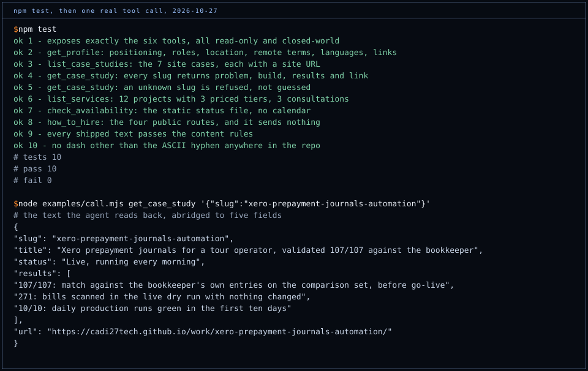

# adrian-capraru-mcp

[](https://github.com/cadi27tech/adrian-capraru-mcp/actions/workflows/ci.yml)

An agent-readable profile. A small Model Context Protocol server that lets Claude, ChatGPT, Cursor or any MCP client answer questions about Adrian Capraru, Head of AI & Automation, and hand a user the routes to hire him: who he is, what he has built and measured, what his published offers cost, whether he is taking work, and where to make contact.

Every answer comes from the data behind [cadi27tech.github.io](https://cadi27tech.github.io). A build script generates `data/profile.json` from the site's own content file, its JSON Resume and the published Upwork offers, so the server says what the site says and nothing else.

- **Registry:** official MCP Registry, `io.github.cadi27tech/adrian-capraru` ([registry entry](https://registry.modelcontextprotocol.io/v0/servers?search=adrian-capraru)), active since 27 Oct 2026
- **Transport:** stdio. Runs with `npx github:cadi27tech/adrian-capraru-mcp`, or as the MCPB bundle attached to each release
- **Auth and network:** none. No key, no account, no outbound call at runtime, nothing written
- **Side effects:** none. `how_to_hire` returns contact routes; it never sends a message or books a call

<picture>
  <source media="(max-width: 600px)" srcset="docs/architecture-m.svg">
  
</picture>

## Tools

All six are read-only (`readOnlyHint: true`, `openWorldHint: false`).

| Tool | Returns |
|---|---|
| `get_profile` | Positioning, summary, all 8 roles with highlights and key figures, location (Romania, EET) and remote terms, what he is open to, languages, education, skills, links |
| `list_case_studies` | The 7 case studies on the site: slug, title, summary, headline figure, status, URL |
| `get_case_study` | One case in full: client type, role, timeline, status, problem, what was built, measured results, stack, links. `slug` is an enum, so an unknown slug is refused rather than guessed |
| `list_services` | 12 fixed-price projects (3 tiers each, USD, delivery days, what is included) and 3 paid consultations, as published on Upwork |
| `check_availability` | The status in `availability.json`, its update date, what he is open to and his time zone. A status note, not a calendar |
| `how_to_hire` | Contact page, Upwork profile, LinkedIn and CV PDF, what each route is for, and what to put in a first message |

Then ask, for example: *"Has Adrian Capraru shipped anything with Xero in production, and what would a HubSpot to Xero build cost?"*

## Connect

Node 20 or later. The first run installs the package from GitHub.

**Claude Code**

```bash
claude mcp add adrian-capraru -- npx -y github:cadi27tech/adrian-capraru-mcp
```

**Claude Desktop** (`claude_desktop_config.json`)

```json
{
  "mcpServers": {
    "adrian-capraru": {
      "command": "npx",
      "args": ["-y", "github:cadi27tech/adrian-capraru-mcp"]
    }
  }
}
```

Or download `adrian-capraru-mcp-1.0.0.mcpb` from the [latest release](https://github.com/cadi27tech/adrian-capraru-mcp/releases/latest) and open it: Claude Desktop installs bundles in one click.

**Cursor** (`~/.cursor/mcp.json`, or `.cursor/mcp.json` in a project)

```json
{
  "mcpServers": {
    "adrian-capraru": {
      "command": "npx",
      "args": ["-y", "github:cadi27tech/adrian-capraru-mcp"]
    }
  }
}
```

On Windows, if the client cannot find `npx`, use `"command": "cmd"` with `"args": ["/c", "npx", "-y", "github:cadi27tech/adrian-capraru-mcp"]`.

**Any client, from a clone:** `npm ci`, then `node examples/call.mjs <tool> '<json arguments>'` starts the server over stdio, calls one tool and prints what the agent reads back.

## Verification



`npm test` starts the real server over stdio and calls every tool the way an MCP client does: exactly six tools and all read-only, the profile fields, all 7 case slugs, an unknown slug refused, 12 projects with three rising price tiers and 3 consultations, the availability file, the four contact routes, and two repository checks. CI runs it on Node 20 and 22 on every push, then calls `how_to_hire` from a clean install.

## Design decisions

**Generated, never typed.** `scripts/build-data.mjs` imports the site's `content.mjs`, reads `resume.json`, lifts the "Open to" and "Where" copy from the contact page source and parses the published Upwork catalog and consultations. A wording change on the site reaches the server on the next build. If the contact page loses a section the script depends on, the build throws instead of shipping a gap.

**Content rules that fail the build.** `scripts/rules.mjs` lists what may never be published: partner names, superlatives, figures withheld on purpose, email addresses, first-person copy, hype words and any dash other than the ASCII hyphen. The build rewrites the few site sentences that carry such a fact, drops any list item still failing, then checks the whole output and refuses to write it if one rule still fails. The tests run the same rules over the data, the README and the changelog.

**Availability is a file, not a calendar.** `availability.json` holds a status, a sentence and a date, edited by hand and read on every call, so an edit applies without a restart. The server never claims a free slot it cannot see.

**Contact stays human.** The server hands back routes and a suggested brief. A person, or an agent acting for one, makes contact. Nothing here can send a message in Adrian's name or on a user's behalf.

## Update the data

```bash
node scripts/build-data.mjs "<folder holding website/ and deliverables/upwork-v3/>"
npm test
```

To change availability, edit `availability.json` (`status`, `summary`, `updated`) and push. Clients running through `npx` pick it up on the next install; the registry bundle changes only with a release.

A new release: bump `version` in `package.json`, `manifest.json` and `server.json`, run `npx @anthropic-ai/mcpb pack`, attach the `.mcpb` to a GitHub release, put its SHA-256 and URL in `server.json`, then run the **publish to MCP Registry** workflow. It checks the hash and signs in with GitHub OIDC, so no secret is stored.

## Licence

MIT. Adrian Capraru, [cadi27tech.github.io](https://cadi27tech.github.io). The drawing is generated with [blueprint-svg](https://github.com/cadi27tech/blueprint-svg).
